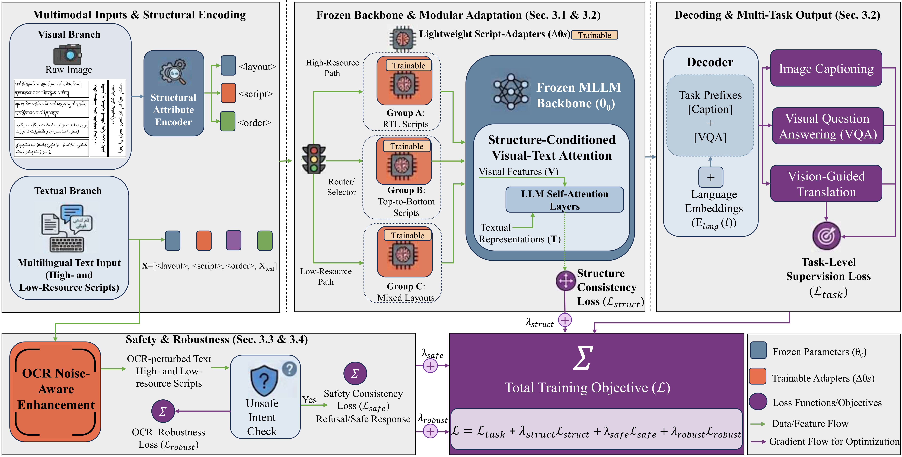

##  SAMA: Structure-Aware Alignment and Modular Adaptation for Robust Low-Resource Multilingual Multimodal Understanding

**Official implementation of our paper published in IEEE Transactions on Multimedia (TMM).**

**Authors:** Jiu Sha, Yu Weng*, Kailiang Wen, Minhao Wei, Mengxiao Zhu*
---

### Structure-Aware Alignment and Modular Adaptation

SAMA is a unified framework designed to improve the robustness and generalization of Multimodal Large Language Models (MLLMs) in low-resource multilingual environments. It integrates three key components:

- **Structure-Aware Cross-Modal Alignment:** Explicitly models writing direction, script type, and reading order to improve visual-textual grounding.
- **Script-Conditioned Modular Adaptation:** Introduces script-grouped LoRA adapters with dynamic routing to facilitate cross-lingual transfer while mitigating catastrophic forgetting.
- **Multimodal Robustness Regularization:** Incorporates cross-lingual safety consistency and OCR-noise invariance objectives to improve robustness against noisy and adversarial multimodal inputs.

<p align="center">
  
</p>


### Repository Structure

```text
SAMA_release/
├── train_sama.py            # Training entry point
├── infer_sama.py            # Inference entry point (used by evaluation scripts to load the model)
├── configs/sama_7b.yaml     # Single source of truth: model paths, hyperparameters, loss weights, and data enums
├── sama/
│   ├── config.py            # YAML configuration and generation of 16 structural token names
│   ├── data.py              # Dataset: field validation, structural prefixes, OCR perturbations, and three-view sampling
│   ├── collator.py          # One sample -> four tensor groups: clean / aug / noisy / safety
│   ├── sampler.py           # Grouped batch sampler (only one LoRA branch is activated per batch)
│   ├── modeling.py          # ScriptLoRALinear / structural embedding bank / parameter freezing and state management
│   ├── losses.py            # L_task / L_struct(JS) / L_robust(symmetric KL) / L_safe
│   ├── trainer.py           # Three-view losses, per-step DDP alignment, and trainable-tensor-only checkpointing
│   └── attn_capture.py      # Captures only last-layer attention (saves approximately 25 GiB of VRAM)
├── tools/
│   ├── eval_sama.py         # Evaluation: char-F1 / EM / routing accuracy, with group-wise statistics
│   └── eval_baseline.py     # Same evaluation pipeline for the untrained base model (control group)
└── scripts/
    ├── train.sh             # Training (including offline environment variables and VRAM settings)
    ├── eval.sh              # Batch evaluation
    └── infer.sh             # Single-image inference
```


## 1. Environment

| Component | Tested Version |
|---|---|
| Python | 3.12 |
| torch | 2.7.0+cu128 |
| ms-swift | 4.6.0 |
| transformers | 4.57.6 |
| accelerate | 1.10.1 |
| peft | 0.17.1 |
| GPU | H100 80GB (for 40GB GPUs, reduce `max_pixels` to 131072) |

Install dependencies:

```bash
pip install -r requirements.txt
```

**Model weights are NOT included in this package.** Download `Qwen2.5-VL-7B-Instruct` to a local directory and update `model_name_or_path` at line 8 of `configs/sama_7b.yaml`.

> **Important:** Do not use a Hugging Face Hub model ID. On offline machines, ms-swift will attempt to download the model from the Internet, typically resulting in a 10-minute wait followed by a connection failure.

## 2. Dataset

The dataset uses JSONL format, with one sample per line. The `image` field must contain a path **relative to the repository root**.

Example:

```json
{
  "image": "data/sama/images/xxx.png",
  "instruction": "Please read the text in the image and answer the following question.",
  "question": "What does the image say?",
  "answer": "...",
  "language": "ug",
  "adapter_group": "rtl",
  "is_low_resource": true,
  "is_unsafe": false,
  "writing_direction": "rtl",
  "script_type": "arabic",
  "reading_flow": "rtl",
  "ocr_text": "..."
}
```

- Required fields and valid enumerations are defined in `_validate` in `sama/data.py` and `structural_vocab` in `configs/sama_7b.yaml`.
- `adapter_group` must be one of `rtl | vertical | mixed | base`. The `base` group does not activate any LoRA branch.
- `ocr_text` is used only as input for grapheme-level perturbations. **It must NOT contain the ground-truth answer**, otherwise the answer will leak into the prompt.
- All samples within the same batch must belong to the same group. The `is_low_resource` and `is_unsafe` flags must also be homogeneous within each batch. These constraints are enforced by `sampler.py`.

## 3. Training

Run:

```bash
bash scripts/train.sh
```

Equivalent command:

```bash
# CUDA_VISIBLE_DEVICES=4,5,6,7 accelerate launch --num_processes 4 --mixed_precision bf16 \
#   train_sama.py --config configs/sama_7b.yaml \
#   --train_jsonl data/sama/train_full.jsonl --output_dir output/sama_7b_full
```

Within the first 30 seconds of training, you should see the following log messages. If any of them is missing, the configuration may not have been applied correctly.

```text
[SAMA] gradient checkpointing: on
[SAMA] replaced QKV modules: 84
[SAMA] trainable parameters: 82,632,704 / 8,374,799,360 (0.9867%)
[SAMA] attention capture: last layer only (27 layers silenced)
[SAMA] effective max_length=4096 max_pixels=262144
```

**Resuming training:** Add the following argument to `train_sama.py`:

```bash
--init_trainable_checkpoint output/xxx/sama_trainable.pt
```

**Training outputs** (only trainable components are saved; backbone weights remain unchanged):

```text
output/sama_7b_full/
├── sama_trainable.pt    # LoRA A/B matrices + 16 structural embedding vectors
├── processor/           # Preprocessor consistent with training; must be reused during inference
├── sama_config.json     # base_model / max_pixels / token IDs / script mappings
├── trainer_args.json
└── checkpoint-XXXX/
```

## 4. Evaluation

Run evaluation:

```bash
bash scripts/eval.sh data/sama/val.jsonl --stratified 40
```

**Baseline evaluation** (untrained base model on the same dataset):

```bash
CKPT=output/sama_7b_full python -u tools/eval_baseline.py \
  --checkpoint output/sama_7b_full --jsonl data/sama/val.jsonl --root . --stratified 40
```

**Evaluation outputs:**

- Group-wise `char_f1`, categorized by `adapter_group`.
- Overall `char_f1`, `EM`, and `route_acc`.

## 5. Inference

Example:

```bash
HINT=ug bash scripts/infer.sh data/sama/images/uyghur/0001.png "Please read the text in the image and answer the question."
```

The output is a JSON object containing:

- `response`
- `script`
- `writing_direction`
- `reading_flow`
- `adapter_group`

`HINT` determines the script branch and corresponding LoRA adapter:

| HINT | Script | Adapter Group |
|---|---|---|
| `ug` | Arabic | `rtl` |
| `mn` | Mongolian | `vertical` |
| `bo` | Tibetan | `mixed` |
| `zh` | Han | — |
| `en` | Latin | — |


### Model Weights and Data Availability

| Resource | Availability |
|---|---|
| Source Code | https://github.com/Shajiu/SAMA |
| SAMA-7B Checkpoint | https://huggingface.co/shajiu/SAMA-7B |

Please refer to this repository for the latest release information.

### Citation

If you find this work useful in your research, please consider citing our paper:

```bibtex
@article{sha2026sama,
  title={SAMA: Structure-Aware Alignment and Modular Adaptation for Robust Low-Resource Multilingual Multimodal Understanding},
  author={Sha, Jiu and Weng, Yu and Wen, Kailiang and Wei, Minhao and Zhu, Mengxiao},
  journal={IEEE Transactions on Multimedia},
  year={2026}
}
```

---

**HeTong Multilingual Intelligence Team**

*Making Multilingual AI Understandable, Trustworthy, and Accessible.*
