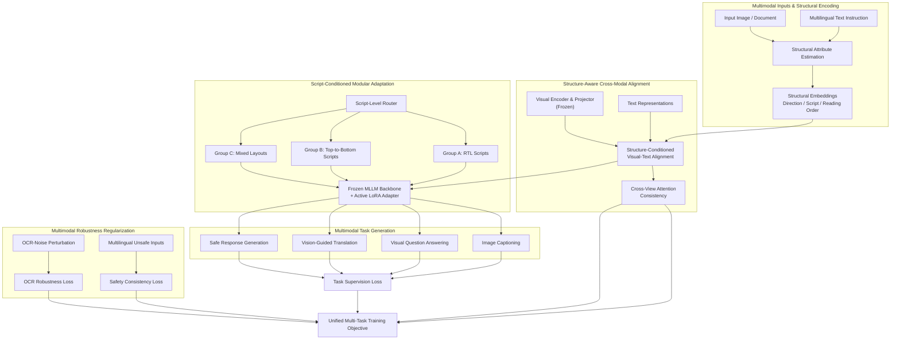

# SAMA: Structure-Aware Alignment and Modular Adaptation for Robust Low-Resource Multilingual Multimodal Understanding

Authors: Jiu Sha, Yu Weng*, Kailiang weng, Minghao Wei, Mengxiao Zhu*


# SAMA: Structure-Aware Alignment and Modular Adaptation for Robust Low-Resource Multilingual Multimodal Understanding

**Official implementation of our IEEE Transactions on Multimedia (TMM) paper.**

<p align="center">
  
</p>

<p align="center">
  <b>Low-Resource Multilingual Multimodal Understanding · Structure-Aware Alignment · Script-Conditioned Adaptation · Multimodal Robustness</b>
</p>

---

## 1. Introduction

**SAMA** (Structure-Aware Alignment and Modular Adaptation) is a unified framework designed to improve the robustness and generalization of Multimodal Large Language Models (MLLMs) in low-resource multilingual environments.

Existing MLLMs often struggle with low-resource languages due to two fundamental challenges:

- **Structural Heterogeneity:** Different writing systems exhibit diverse writing directions, script characteristics, and reading orders, including left-to-right, right-to-left, and top-to-bottom layouts. These variations can cause incorrect visual-textual alignment and unreliable multimodal understanding.
- **Script Vulnerability:** Low-resource scripts are more susceptible to OCR errors, character-level perturbations, and visually obfuscated malicious instructions, increasing the risk of multimodal jailbreak attacks.

To address these challenges, we propose SAMA, which integrates three complementary components:

1. **Structure-Aware Cross-Modal Alignment:** Explicitly encodes writing direction, script type, and reading order as structural conditioning signals, while introducing cross-view attention consistency to improve visual grounding.
2. **Script-Conditioned Modular Adaptation:** Organizes lightweight LoRA adapters according to script-level characteristics and dynamically activates the corresponding adaptation branch for different inputs.
3. **Multimodal Robustness Regularization:** Introduces cross-lingual safety consistency and OCR-noise invariance objectives to improve robustness against noisy and adversarial multimodal inputs.

SAMA provides a parameter-efficient solution for multilingual multimodal adaptation while preserving the capabilities of high-resource languages.

### Key Contributions

- A structure-aware cross-modal alignment mechanism that explicitly models heterogeneous writing systems and visual reading orders.
- A script-grouped modular adaptation strategy that enables efficient multilingual transfer while mitigating catastrophic forgetting.
- A unified multimodal robustness objective for cross-lingual safety consistency and OCR-noise tolerance.
- A hybrid multilingual multimodal dataset combining real-world acquisition and distribution-guided reverse synthesis.
- Comprehensive evaluations across multilingual captioning, visual question answering, vision-guided translation, and multimodal jailbreak safety.

## 2. Overall Framework

The overall architecture of SAMA consists of three main components: structure-aware alignment, script-conditioned modular adaptation, and multimodal robustness regularization.

### Framework Overview



*Figure: Overall architecture of SAMA. The framework combines structural conditioning, script-level modular adaptation, and multimodal robustness objectives.*

### 2.1 Structure-Aware Cross-Modal Alignment

SAMA explicitly models three structural attributes:

- **Writing Direction:** Left-to-right, right-to-left, etc.
- **Script Type:** Language and writing-system characteristics.
- **Reading Order:** Dominant spatial reading flow, including horizontal, vertical, and mixed layouts.

These attributes are mapped into learnable structural embeddings and incorporated into the multimodal input sequence.

Furthermore, a cross-view attention consistency objective encourages stable answer-to-visual attention distributions under semantics-preserving perturbations.

### 2.2 Script-Conditioned Modular Adaptation

Instead of maintaining independent adapters for every language, SAMA groups languages according to script-level structural characteristics.

Lightweight LoRA modules are introduced for different script groups:

- Group A: Right-to-left scripts.
- Group B: Top-to-bottom scripts.
- Group C: Mixed-layout scripts.

During inference, a lightweight router activates only the corresponding adapter branch.

This strategy reduces cross-lingual interference and mitigates catastrophic forgetting while maintaining parameter efficiency.

### 2.3 Multimodal Robustness Regularization

We introduce two complementary robustness objectives:

- **Cross-Lingual Safety Consistency:** Encourages consistent refusal behavior across languages and visual layouts when facing unsafe instructions.
- **OCR Noise Invariance:** Uses character-level perturbations to improve robustness against OCR errors and noisy textual inputs.

The complete training objective is:

\[
\mathcal{L}_{total} =
\mathcal{L}_{task}
+\lambda_1\mathcal{L}_{struct}
+\lambda_2\mathcal{L}_{safe}
+\lambda_3\mathcal{L}_{robust}.
\]

## 3. Dataset

We construct a multilingual multimodal dataset using a hybrid data construction pipeline:

- **Forward Acquisition:** Real-world in-situ image collection, multimodal extraction, human verification, and cultural localization.
- **Reverse Synthesis:** Distribution-guided synthetic data generation based on empirical task, layout, and language distributions.

### Dataset Statistics

| Category | Statistics |
|---|---:|
| Total samples | 37,140 |
| Training samples | 25,920 |
| Low-resource training samples | 22,680 |
| High-resource auxiliary samples | 3,240 |
| Evaluation samples | 11,220 |
| In-domain evaluation | 9,720 |
| Independent-Real evaluation | 1,500 |
| Languages | 5 |
| Multimodal task families | 4 |
| Domains | 9 |

**Language Coverage**

- Low-resource languages: Tibetan (bo), Uyghur (ug), and Mongolian (mn).
- High-resource auxiliary languages: Chinese (ch) and English (en).

**Task Coverage**

1. Image Captioning
2. Visual Question Answering (VQA)
3. Vision-Guided Translation
4. Multilingual Multimodal Jailbreak Safety

**Evaluation Protocol**

The evaluation data are organized into three conditions:

- **Synthetic:** In-domain evaluation using synthesized images.
- **Real:** In-domain evaluation using real-world images.
- **Independent-Real:** Source-disjoint evaluation using previously unused real-world collection materials.

The Independent-Real subset contains 1,500 instances, with 500 instances per low-resource language. Its original sources, acquisition sessions, and specific cultural entities are disjoint from the original corpus and synthesis materials.

The dataset combines approximately 52.02% real-world acquisition and 47.98% distribution-guided synthesis.

## 4. Experimental Results

We evaluate SAMA against 13 representative multimodal models, including multilingual MLLMs, general-purpose models, and supervised fine-tuning baselines.

### 4.1 Main Evaluation

SAMA demonstrates improvements across multilingual generation, understanding, translation, and safety evaluation.

| Task | Evaluation Metrics |
|---|---|
| Image Captioning | BLEU, ROUGE-1, ROUGE-L, Semantic Similarity |
| Visual Question Answering | Accuracy, BLEU, ROUGE, Semantic Similarity |
| Vision-Guided Translation | BLEU, Semantic Similarity |
| Multimodal Jailbreak | Attack Success Rate (ASR), Refusal Rate (RR) |

### 4.2 Structural Grounding

On the structure-sensitive evaluation subset, SAMA-7B achieves the following reading-order accuracy:

| Layout | Reading-Order Accuracy |
|---|---:|
| Left-to-Right | 78.1 |
| Right-to-Left | 82.4 |
| Vertical | 79.6 |
| Mixed | 73.8 |

Removing structural tokens and structure-consistency regularization causes a 15.60-point VQA accuracy drop on Uyghur RTL inputs and a 15.65-point drop on vertical Mongolian inputs.

### 4.3 Multimodal Safety

SAMA-7B achieves an average in-domain attack success rate of **15.53%**, demonstrating improved robustness against multilingual multimodal jailbreak attacks.

### 4.4 Parameter Efficiency

Under the reported Qwen-2.5-VL-7B experimental setting:

| Configuration | Trainable Parameters |
|---|---:|
| Full SFT | 7.2B |
| Global LoRA | 38.4M |
| SAMA-7B | 115.4M |

SAMA activates only one script-conditioned adapter branch for each input. Adapter merging further eliminates additional LoRA forward-pass operations.

## 5. Installation

Clone the repository:

```bash
git clone https://github.com/Shajiu/SAMA.git
cd SAMA
```

Install the dependencies after the environment configuration is released:

```bash
pip install -r requirements.txt
```

**Note:** The exact dependency versions and installation instructions will be updated alongside the released implementation.

## 6. Model Configuration

The experiments use Qwen-2.5-VL-3B-Instruct and Qwen-2.5-VL-7B-Instruct as the multimodal backbones.

The main reported training configuration is summarized below:

| Parameter | Configuration |
|---|---|
| Backbone | Qwen-2.5-VL-3B/7B-Instruct |
| Adaptation | Script-Conditioned LoRA |
| LoRA Rank | 64 |
| LoRA Alpha | 128 |
| Target Modules | Q, K, V |
| Visual Encoder | Frozen |
| Multimodal Projector | Frozen |
| Optimizer | AdamW |
| Weight Decay | 0.1 |
| Learning Rate | 1e-5 |
| Scheduler | Cosine |
| Warmup Ratio | 10% |
| Effective Batch Size | 128 |
| Training Epochs | 3 |
| OCR Perturbation Probability | 15% |
| Structural Loss Weight | 0.5 |
| Safety Loss Weight | 1.0 |
| Robustness Loss Weight | 0.5 |
| Training Hardware | 32 NVIDIA H800 GPUs |

The maximum image resolution is configured using a dynamic-resolution strategy with a maximum size of 262,144 pixels.

## 7. Training

SAMA is trained using a unified multi-task optimization strategy. The training process jointly optimizes task supervision, structural alignment, cross-lingual safety consistency, and OCR robustness.

### Training Pipeline

1. Load the pretrained Qwen-2.5-VL backbone.
2. Initialize structural embeddings and script-conditioned LoRA modules.
3. Load multilingual multimodal training samples and structural metadata.
4. Apply structural consistency and OCR-noise perturbations.
5. Perform multi-task supervised training with auxiliary robustness objectives.
6. Save the final model checkpoint and modular adapter parameters.

### Training Command

The following is a command template. The actual script names and arguments will be synchronized with the released implementation.

```bash
# Set model and dataset paths
BASE_MODEL=/path/to/Qwen2.5-VL-7B-Instruct
TRAIN_DATA=/path/to/SAMA_train
OUTPUT_DIR=/path/to/SAMA-7B

# Launch SAMA training
python <TRAINING_SCRIPT> \
    --model_name_or_path ${BASE_MODEL} \
    --train_data ${TRAIN_DATA} \
    --output_dir ${OUTPUT_DIR}
```

The final implementation will include the exact training entry point, configuration files, distributed training settings, and checkpoint-saving procedure.

## 8. Inference

At inference time, SAMA automatically determines the structural attributes of the input and activates the corresponding script-conditioned adapter.

### Inference Pipeline

1. **Input Processing:** Receive an image and multilingual instruction.
2. **Structural Estimation:** Infer script type, writing direction, and dominant reading order using detected text regions, Unicode ranges, and language identification signals.
3. **Adapter Routing:** Select the corresponding script-conditioned LoRA branch.
4. **Multimodal Reasoning:** Perform structure-conditioned visual-textual reasoning through the adapted MLLM.
5. **Response Generation:** Generate the requested multilingual output.

For mixed-script samples, the dominant script and reading flow are determined according to the largest text-region proportion.

### Inference Command

The following is an illustrative command template; the actual arguments will be updated according to the released inference implementation.

```bash
MODEL_PATH=/path/to/SAMA-7B
IMAGE_PATH=/path/to/example.jpg

python <INFERENCE_SCRIPT> \
    --model_path ${MODEL_PATH} \
    --image_path ${IMAGE_PATH} \
    --language ug \
    --task vqa \
    --prompt "Please describe the content of this image."
```

Supported language identifiers:

| Language | Identifier |
|---|---|
| Tibetan | bo |
| Uyghur | ug |
| Mongolian | mn |
| Chinese | ch |
| English | en |

The selected LoRA branch can also be merged into the backbone for deployment.

## 9. Repository Structure

The following is the planned repository organization and will be adjusted to match the actual source-code release.

```text
SAMA/
│
├── configs/
│   ├── sama_3b.yaml
│   └── sama_7b.yaml
│
├── data/
│   ├── README.md
│   └── examples/
│
├── models/
│   └── README.md
│
├── scripts/
│   ├── train.sh
│   └── inference.sh
│
├── sama/
│   ├── modeling/
│   ├── alignment/
│   ├── adapters/
│   ├── routing/
│   └── robustness/
│
├── train.py
├── inference.py
├── evaluate.py
├── requirements.txt
└── README.md
```

## 10. Model Weights and Data Availability

The following resources will be updated as they become available:

| Resource | Availability |
|---|---|
| Source Code | Repository release |
| SAMA-3B Checkpoint | To be updated |
| SAMA-7B Checkpoint | To be updated |
| Training Dataset | Access information to be updated |
| Evaluation Dataset | Access information to be updated |
| Evaluation Scripts | To be updated |

Please refer to this repository for the latest release information.

## 11. Limitations

SAMA currently focuses on Tibetan, Uyghur, and Mongolian, and does not cover all low-resource languages or script families. Its structural estimation also depends on the accuracy of script and layout identification, particularly for dense mixed-script documents and heavily occluded scenes.

In addition, although the dataset incorporates real-world acquisition, distribution-guided synthesis, and native-speaker auditing, synthetic data may still introduce distributional biases. Future work will explore broader language coverage, more reliable structural estimation, and more comprehensive multimodal safety evaluation.

## 12. Citation

If you find this work useful in your research, please consider citing our paper:

```bibtex
@article{sha2026sama,
  title={SAMA: Structure-Aware Alignment and Modular Adaptation for Robust Low-Resource Multilingual Multimodal Understanding},
  author={Sha, Jiu and Weng, Yu and Wen, Kailiang and Wei, Minhao and Zhu, Mengxiao},
  journal={IEEE Transactions on Multimedia},
  year={2026}
}
```

## 13. Acknowledgements

This work is supported by the research teams and institutions contributing to multilingual multimodal understanding and intelligent language processing.

We sincerely thank all collaborators, native-language annotators, and reviewers for their valuable contributions.

---

**HeTong Multilingual Intelligence Team**

*Making Multilingual AI Understandable, Trustworthy, and Accessible.*
