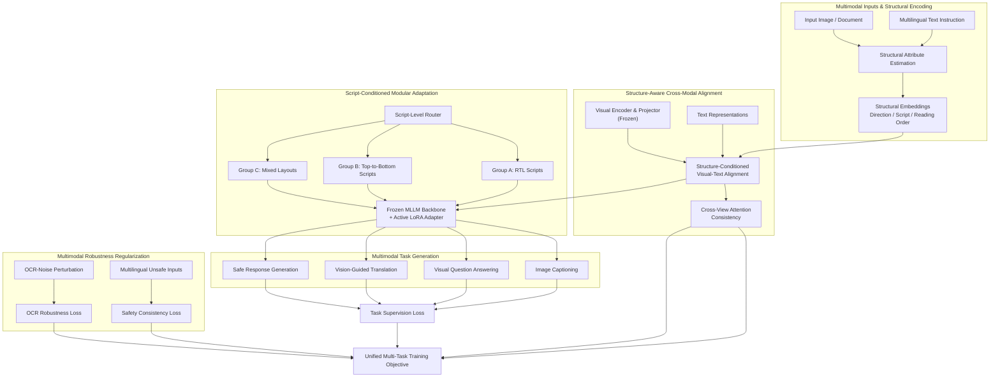

# SAMA: Structure-Aware Alignment and Modular Adaptation for Robust Low-Resource Multilingual Multimodal Understanding

**Official implementation of our IEEE Transactions on Multimedia (TMM) paper.**

Authors: Jiu Sha, Yu Weng*, Kailiang weng, Minghao Wei, Mengxiao Zhu*


### Structure-Aware Alignment and Modular Adaptation

SAMA is a unified framework designed to improve the robustness and generalization of Multimodal Large Language Models (MLLMs) in low-resource multilingual environments.

### Framework Overview




### Training

SAMA is trained using a unified multi-task optimization strategy. The training process jointly optimizes task supervision, structural alignment, cross-lingual safety consistency, and OCR robustness.

### Training Pipeline

1. Load the pretrained Qwen-2.5-VL backbone.
2. Initialize structural embeddings and script-conditioned LoRA modules.
3. Load multilingual multimodal training samples and structural metadata.
4. Apply structural consistency and OCR-noise perturbations.
5. Perform multi-task supervised training with auxiliary robustness objectives.
6. Save the final model checkpoint and modular adapter parameters.

### Training Command

The following is a command template. The actual script names and arguments will be synchronized with the released implementation.

```bash
# Set model and dataset paths
BASE_MODEL=/path/to/Qwen2.5-VL-7B-Instruct
TRAIN_DATA=/path/to/SAMA_train
OUTPUT_DIR=/path/to/SAMA-7B

# Launch SAMA training
python <TRAINING_SCRIPT> \
    --model_name_or_path ${BASE_MODEL} \
    --train_data ${TRAIN_DATA} \
    --output_dir ${OUTPUT_DIR}
```

The final implementation will include the exact training entry point, configuration files, distributed training settings, and checkpoint-saving procedure.

## 8. Inference

At inference time, SAMA automatically determines the structural attributes of the input and activates the corresponding script-conditioned adapter.

### Inference Pipeline

1. **Input Processing:** Receive an image and multilingual instruction.
2. **Structural Estimation:** Infer script type, writing direction, and dominant reading order using detected text regions, Unicode ranges, and language identification signals.
3. **Adapter Routing:** Select the corresponding script-conditioned LoRA branch.
4. **Multimodal Reasoning:** Perform structure-conditioned visual-textual reasoning through the adapted MLLM.
5. **Response Generation:** Generate the requested multilingual output.

For mixed-script samples, the dominant script and reading flow are determined according to the largest text-region proportion.

### Inference Command

The following is an illustrative command template; the actual arguments will be updated according to the released inference implementation.

```bash
MODEL_PATH=/path/to/SAMA-7B
IMAGE_PATH=/path/to/example.jpg

python <INFERENCE_SCRIPT> \
    --model_path ${MODEL_PATH} \
    --image_path ${IMAGE_PATH} \
    --language ug \
    --task vqa \
    --prompt "Please describe the content of this image."
```


## 9. Repository Structure

The following is the planned repository organization and will be adjusted to match the actual source-code release.

```text
SAMA/
│
├── configs/
│   ├── sama_3b.yaml
│   └── sama_7b.yaml
│
├── data/
│   ├── README.md
│   └── examples/
│
├── models/
│   └── README.md
│
├── scripts/
│   ├── train.sh
│   └── inference.sh
│
├── sama/
│   ├── modeling/
│   ├── alignment/
│   ├── adapters/
│   ├── routing/
│   └── robustness/
│
├── train.py
├── inference.py
├── evaluate.py
├── requirements.txt
└── README.md
```

## 10. Model Weights and Data Availability

The following resources will be updated as they become available:

| Resource | Availability |
|---|---|
| Source Code | Repository release |
| SAMA-3B Checkpoint | To be updated |
| SAMA-7B Checkpoint | To be updated |
| Training Dataset | Access information to be updated |
| Evaluation Dataset | Access information to be updated |
| Evaluation Scripts | To be updated |

Please refer to this repository for the latest release information.


## 12. Citation

If you find this work useful in your research, please consider citing our paper:

```bibtex
@article{sha2026sama,
  title={SAMA: Structure-Aware Alignment and Modular Adaptation for Robust Low-Resource Multilingual Multimodal Understanding},
  author={Sha, Jiu and Weng, Yu and Wen, Kailiang and Wei, Minhao and Zhu, Mengxiao},
  journal={IEEE Transactions on Multimedia},
  year={2026}
}
```

**HeTong Multilingual Intelligence Team**

*Making Multilingual AI Understandable, Trustworthy, and Accessible.*
